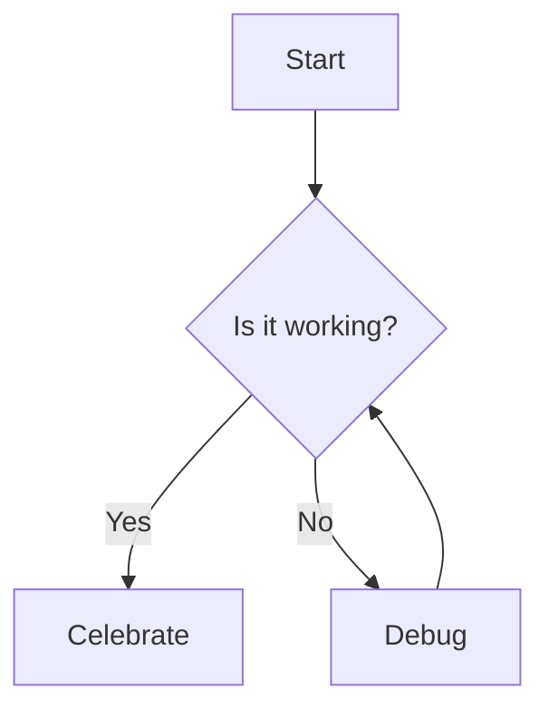

# Writing Inkdrop Notes

Inkdrop renders GitHub-flavored markdown plus a few extras. Reach for these when
composing any note body destined for Inkdrop, so the result is navigable and
readable later.

## Code snippets

Inkdrop supports **code-block attributes** on the fence info string, after the
language. `filename="…"` and `title="…"` are quoted; `line=N`, `commit=<hash>`,
and `url=<github-blob-url>` are unquoted.

````markdown
```tsx filename="src/index.ts" line=70 title="what this snippet shows"
const filteredTags = workspace.loading ? {} : stats?.tags || {};
```
````

- Add `filename` (and `line` when pointing at a specific spot) — it makes the
  snippet clickable in Inkdrop. Add `title` to say what the snippet demonstrates.
- Prefer `filename`+`line` over `commit`/`url` when the code is uncommitted or the
  repo is private — a GitHub permalink would 404 or go stale.
- `commit`+`url` link a snippet to a permalink when the code is public and pushed:

  ````markdown
  ```ts line=70 commit=f58b8ee url=https://github.com/inkdropapp/mcp-server/blob/f58b8ee/src/index.ts#L70-L77
  server.tool('search-notes', ...)
  ```
  ````

- Use a ` ```diff ` block to show a before/after change.

## Diagrams (Mermaid)

When something is about **sequence, timing, flow, or architecture**, a Mermaid
diagram conveys the mechanism faster than prose. Use a ` ```mermaid ` block.

````markdown

````

For timing/ordering bugs, a `sequenceDiagram` is usually the clearest form.

## Math (KaTeX)

For algorithms or calculations, represent the logic with KaTeX inside a ` ```math `
block.

````markdown
```math
\begin{align*}
E &= mc^2 \\
F &= ma
\end{align*}
```
````

## Linking notes

Inkdrop has **no wiki-link (`[[…]]`) syntax**. Link a note by its URI instead:

- **Note URI** — link to a specific note with `inkdrop://note/<noteId>`. Convert a
  note id to the URI by dropping the `note:` prefix: `note:tFz4sfEw` →
  `inkdrop://note/tFz4sfEw`, written as `[Note title](inkdrop://note/tFz4sfEw)`.
- **Don't know the note ID?** Find it with the `search-notes` tool on the Inkdrop
  MCP server (search by title or keyword), then build the URI from the returned id.
- When reporting a created or updated note back to the user, give the
  `inkdrop://note/<noteId>` link.
